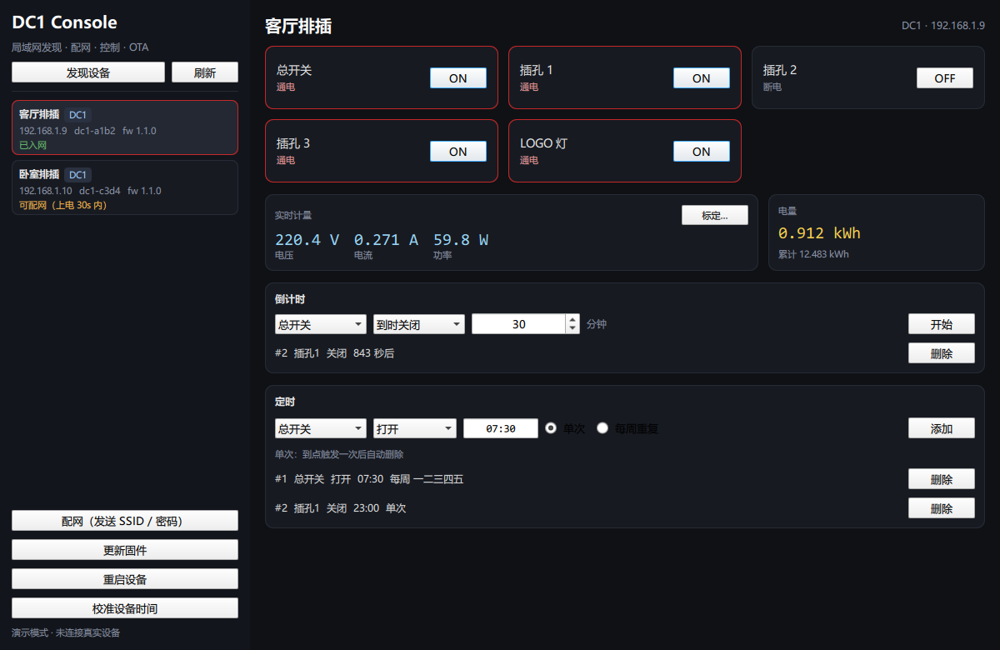

# DC1 Console · 斐讯 DC1 排插的内网自持方案

[](LICENSE)
[]()
[]()
[]()
[](https://github.com/angle600/dc1-console/actions/workflows/check.yml)

> 仓库：<https://github.com/angle600/dc1-console>

把**斐讯 DC1 智能排插**改成一台完全本地运行的设备：MicroPython 固件跑在排插上，
手机/PC 在局域网内发现它、给它配网、控制它；上位机是 Qt 6.8（QML）桌面程序，
业务逻辑全部在 Python CLI 里，GUI 只负责展示。

> 官方云已停运，本方案不依赖任何服务器、不注册账号、不出公网。

```
┌────────────────────┐   QProcess(stdout)   ┌────────────────────┐
│  dc1console (Qt6)  │ ───────────────────► │  cli/dc1ctl.py     │
│  QML: 列表/面板     │ ◄─────────────────── │  Python 3, 标准库   │
└────────────────────┘        JSON          └─────────┬──────────┘
                                                     │ UDP 54321（发现/配网）
                                                     │ HTTP 80（控制/OTA）
                                           ┌─────────▼──────────┐
                                           │  DC1 (ESP8266 1MB)  │
                                           │  MicroPython 1.29   │
                                           │  CAT9554 + CSE7766  │
                                           └────────────────────┘
```

## 功能

| 模块 | 能力 |
|---|---|
| 固件 | UDP 54321 广播发现；**上电 30 秒内**接受 UDP 配网；开关 4 路 + LOGO 灯 |
| 定时 | **单次**（触发一次后自动删除）/ **每周重复**（周一~周日任意勾选） |
| 倒计时 | 指定插孔在 N 分钟后开或关，支持多条并发 |
| 电量 | 实时 V/A/W + 今日/累计 kWh（CSE7766，系数可标定） |
| 上位机 | 发现设备、按 `type` 选界面、配网、开关、定时、倒计时、电量、**WiFi 更新固件** |
| 扩展 | 设备类型由 `type` + `features` 驱动，新增类型只需加一个 Panel |
| **TC1** | **6 位收纳排插的"换脑"支持**（原厂主控非 ESP8266，见下节与 `docs/08-TC1方案.md`） |

## TC1 支持（换脑方案）

斐讯 TC1 是 6 位收纳排插（6 路 + 4 USB），但原厂主控**不是 ESP8266**：
A1 = MXCHIP EMW3031（MiCO）、A2 = HF-LPT230（汉枫固件），都跑不了 MicroPython。
本仓库的做法是**换脑**——拆掉原模组、焊 ESP-12S 转接板，跑 `firmware/tc1/`，
对外协议与 DC1 逐字一致，`cli/dc1ctl.py` 与上位机按 `type` 自动切面板（6 路）。

| 项 | DC1 | TC1 |
|---|---|---|
| 主控 | ESP8266（可直接刷） | A1 EMW3031 / A2 HF-LPT230（**必须先换脑**） |
| 通道 | total + 3 路 + LOGO 灯 | total（虚拟）+ 6 路 |
| 计量 | CSE7766：V/A/W | BL0937：**只有 W**（出厂只贴 CF 通道） |
| 总控 | 总继电器 | 盒体机械开关 + 固件广播 6 路 |

资料：`hardware/tc1/`（社区反推原理图、拆机与烧录实拍、BL0937/HF-LPT230/EMW3031 手册、自绘框图）
→ 接线与烧录步骤见 [`docs/08-TC1方案.md`](docs/08-TC1方案.md)。

## 界面



> 截图由 `DC1_DEMO=1 dc1console.exe` 生成（演示数据，不连真实设备）。

## 目录

```
.
├── README.md
├── cli/dc1ctl.py                 # 唯一业务入口（发现/配网/控制/定时/OTA）
├── firmware/micropython/         # DC1 设备端固件
│   ├── main.py                   # 配网 + HTTP API + 主循环
│   ├── store.py                  # 定时/倒计时/电量 持久化
│   ├── cat9554.py  cse7766.py    # U7 IO 扩展 / 电量计
│   └── webui.py                  # 手机网页（备用控制面）
├── firmware/tc1/                 # TC1 换脑固件（ESP-12S）
│   ├── main.py  app.py           # 启动器 + HTTP/UDP + 主循环
│   ├── board.py  bl0937.py       # 引脚/继电器/按键 + CF 功率计量
│   ├── store.py                  # 与 DC1 同源
│   └── index.html                # 手机网页（6 路）
├── gui/                          # Qt 6.8.5 MinGW64 上位机
│   ├── CMakeLists.txt
│   ├── main.cpp  clirunner.{h,cpp}
│   └── qml/{Main,StripPanel,GenericPanel,ProvisionDialog,FirmwareDialog}.qml
├── hardware/                     # DC1 电路资料 + DC1-原理框图.svg
├── hardware/tc1/                 # TC1 电路资料（社区反推）+ TC1-原理框图.svg
├── docs/                         # 刷机 / 配网 / AI 控制 / MicroPython 方案
└── tools/                        # 辅助脚本
    ├── mp_deploy.py              # WiFi 推固件 / 串口烧内核
    └── pico_esp_flasher/         # Pico 版 ESP 下载器：USB-UART + IO0 + 3.3V 通断
```

## 编译与自检（本机已验证）

| 目标 | 命令 | 结果 |
|---|---|---|
| GUI | `cmake -S gui -B gui/build -G "MinGW Makefiles" -DCMAKE_PREFIX_PATH=D:/Qt/Qt6.8.5MinGW64 ...` | ✅ `gui/build/dc1console.exe` 151 KB |
| GUI 运行 | `release\dc1console.exe`（无需 Qt 在 PATH） | ✅ 界面正常，QML 无告警（见上方截图） |
| GUI 分发 | `gui\deploy.ps1`（windeployqt + 清理 debug 库） | ✅ `gui/release/` 178 MB 自包含，隔离 PATH 实测可跑 |
| 固件字节码 | `python -m py_compile firmware/micropython/*.py` | ✅ 6 个文件通过 |
| 固件交叉编译 | `mpy-cross`（v1.29.0，mpy v6.3） | ✅ 生成 5 个 `.mpy`（main 9.6 KB、webui 5.7 KB…） |
| 固件逻辑单测 | `python tests/test_store.py` | ✅ 4/4 PASS（单次/每周/倒计时/电量） |

实测环境：CMake 3.26.4 + MinGW-w64 GCC 13.1.0（UCRT）+ Qt 6.8.5 MinGW64。

```bat
:: 一条命令（工具链都在 D://Qt 下）
set MINGW=D://Qt//winlibs-x86_64-posix-seh-gcc-13.1.0-llvm-16.0.5-mingw-w64ucrt-11.0.0-r5//mingw64//bin
set PATH=%MINGW%;D://Qt//Qt6.8.5MinGW64//bin;%PATH%
cmake -S gui -B gui\build -G "MinGW Makefiles" ^
      -DCMAKE_BUILD_TYPE=Release ^
      -DCMAKE_PREFIX_PATH=D:/Qt/Qt6.8.5MinGW64 ^
      -DCMAKE_CXX_COMPILER=%MINGW%/g++.exe ^
      -DCMAKE_MAKE_PROGRAM=%MINGW%/mingw32-make.exe
cmake --build gui\build -j
```

> **固件 `.bin` 没有在本机产出**：ESP8266 内核需 `xtensa-lx106-elf-gcc` 交叉工具链（本机未安装）。
> 需要时用官方 1M 变体（607 KB）或按第 6 节命令自行编译；日常更新用 `fw update`（`.py`/`.mpy`）即可。


## 快速开始

### 1. 刷固件（仅首次需要串口）

接线只需 4 根 + 1 个短接：`3V3→3.3V`、`GND→GND`、`TTL RX→LOG_TX`、`TTL TX→RX1`，
再把 `IO0→GND` 短接进下载模式（细节与测试点位置见 [`docs/01-刷机方案.md`](docs/01-刷机方案.md) §5）。

```bash
# 1) 备份原厂固件（拆机接 TTL，IO0 接 GND 进下载模式）
esptool.py --port COM5 --before no_reset read_flash 0 0x100000 backup_dc1.bin

# 2) 烧 MicroPython 1M 内核（1MB Flash 专用变体，607KB）
python tools/mp_deploy.py --serial COM5 --erase \
    --flash-img ESP8266_GENERIC-FLASH_1M-20260824-v1.29.0.bin

# 3) 烧业务代码（串口或 WiFi 均可）
python cli/dc1ctl.py --ip 192.168.4.1 fw update --dir firmware/micropython
```

### 2. 配网（两种场景）

```bash
# 设备已入网：直接配（会保存并重启）
python cli/dc1ctl.py prov --ssid MyHome2.4G --pass 12345678 --name 客厅排插

# 设备全新：会开热点 DC1-Setup/dc1setup，PC 连上热点后
python cli/dc1ctl.py --ip 192.168.4.1 prov --ssid MyHome2.4G --pass 12345678
```

> 配网窗口只有**上电后 30 秒**（`PROV_WINDOW_MS`）。超时后回 `window_closed`，断电重来即可。

### 3. CLI 日常操作

```bash
python cli/dc1ctl.py discover                        # 广播发现
python cli/dc1ctl.py state                           # 开关 + 计量 + 电量
python cli/dc1ctl.py switch --ch 1 --on 1            # 开插孔1
python cli/dc1ctl.py sched add --ch 1 --on 0 --at 23:00 --once          # 单次
python cli/dc1ctl.py sched add --ch total --on 1 --at 07:30 --days 1,2,3,4,5  # 每周一~五
python cli/dc1ctl.py countdown add --ch 1 --on 0 --min 30               # 30 分钟后关
python cli/dc1ctl.py time                            # 校时（定时功能依赖）
python cli/dc1ctl.py fw update --ip 192.168.1.9      # WiFi 覆盖源码
python cli/dc1ctl.py fw update --mpy --ip 192.168.1.9  # 传 mpy 产物（省 RAM，main.py 仍传源码）
python cli/dc1ctl.py cal --power 40                  # 用 40W 基准负载标定功率
```

所有命令加 `--json` 输出机器可读结果——GUI 就是靠这个契约工作的。

### 4. 构建上位机（Qt 6.8.5 MinGW64）

```bat
:: Qt: D:\Qt\Qt6.8.5MinGW64   CMake 3.21+   Generator: MinGW Makefiles
cd gui
cmake -S . -B build -G "MinGW Makefiles" ^
      -DCMAKE_PREFIX_PATH=D:/Qt/Qt6.8.5MinGW64 ^
      -DCMAKE_C_COMPILER=D:/Qt/Tools/mingw1310_64/bin/gcc.exe ^
      -DCMAKE_CXX_COMPILER=D:/Qt/Tools/mingw1310_64/bin/g++.exe
cmake --build build -j
windeployqt --qmldir qml build/dc1console.exe
```

运行前确保 `python` 在 PATH（或设置 `DC1_PYTHON`）；CLI 路径优先取 `DC1_CLI`，
否则依次找 `./cli/dc1ctl.py`、`../cli/dc1ctl.py` 与源码树。

## 协议（内网，明文；读状态无需鉴权）

### UDP 54321

| 方向 | 报文 | 说明 |
|---|---|---|
| 上位机 → 广播 | `{"t":"discover","proto":1}` | 发现 |
| 设备 → 单播 | `{"t":"dev","type":"DC1","id":"dc1-a1b2","name":"客厅排插","ip":"192.168.1.9","fw":"1.1.0","prov":1,"features":[...]}` | 设备信息 |
| 上位机 → 广播 | `{"t":"prov","ssid":"...","pass":"...","name":"可选"}` | 配网（仅 30s 窗口） |
| 设备 → 单播 | `{"t":"prov","ok":1}` / `{"t":"prov","ok":0,"err":"window_closed"}` | 结果 |

### HTTP（端口 80）

| 方法 | 路径 | 说明 |
|---|---|---|
| GET | `/api/info` | 身份（type/id/fw/mac/features） |
| GET | `/api/state` | 开关 + 计量 + 电量 + 倒计时 |
| GET | `/api/switch?ch=1&on=1` | 控制（`total/1/2/3/logo`） |
| GET/POST | `/api/schedule` | 定时列表 / `{"op":"add\|del\|en\|clear"}` |
| GET/POST | `/api/countdown` | 倒计时 / `{"op":"add\|del\|clear"}` |
| GET | `/api/energy` | `{"total_kwh":..,"today_kwh":..}` |
| POST | `/api/time` | 校时 `{"epoch":...}` |
| POST | `/api/config` | 改配置（需 `X-Token`，可 `wifi_reset`） |
| PUT | `/api/file?name=main.py` | 覆盖源码（需 `X-Token`） |
| POST | `/api/reboot` | 重启 |

定时规则示例：

```json
{"id":3,"ch":"1","on":0,"hh":23,"mm":0,"days":0,"en":1}
```

`days` 是位掩码（bit0=周一 … bit6=周日）；**`days=0` 表示单次**，触发后自动删除；
`127` = 每天。

## 硬件要点

| 信号 | 引脚 | 说明 |
|---|---|---|
| U7 CAT9554 | I2C `GPIO3/GPIO12` @20kHz，0x20 | P0~P2 按键，P4~P7 继电器（P7=总闸） |
| CSE7766 | UART0 swap 到 `GPIO15/13`，4800 8E1 | 计量；swap 后串口 REPL 会搬走 |
| 总按键 | GPIO16（下拉，按下为高） | 上电按住 = 安全模式，保留 REPL |
| LOGO 灯 | GPIO14（低有效） | — |

电路资料与反推过程见 [`hardware/README.md`](hardware/README.md) 与
[`hardware/DC1-原理框图.svg`](hardware/DC1-原理框图.svg)。

## 电量计量与标定

**硬件**：每台 DC1 一颗 CSE7766（U11），串在**整排总回路**上 —— 量的是"这一排总共用了多少"，
不是每个插孔独立计量（分路只能靠软件按开关状态估算）。

**芯片给的是周期计数，不是伏特**（手册 Rev1.2 §3.5.2）：

```
U = Uk / (Ut × V2R)      I = Ik / (It × V1R)      P = Pk / (Pt × V1R × V2R)
```

`Uk/Ik/Pk` 是芯片出厂校准系数（随帧下发），`Ut/It/Pt` 是周期，`V1R`=采样锰铜电阻(mΩ)、
`V2R`=分压电阻(MΩ)。DC1 的 V1R/V2R 未公开，固件统一按 1.0 处理，用 `v/i/p_gain` 做**单点标定**：

```
gain_new = 真实值 × 周期 ÷ 系数     # 固件 /api/cal 直接算，不用重启
```

### 怎么标（GUI / CLI 都行）

- GUI：选中设备 → 「实时计量」卡右上角 **标定…** → 选参量（功率/电压/电流）→ 填电表读数 → 写入系数
- CLI：`python cli/dc1ctl.py cal --power 40` / `cal --voltage 220.3` / `cal`（查看）/ `cal --reset`

### 用回原厂标定（数据没丢，只在芯片里）

CSE7766 的 `Uk/Ik/Pk` 是**出厂烧进芯片**的校准系数，随每一帧下发；**刷固件不会动它**。
所以 `cal` 能直接看到原厂系数，缺的只有两个**硬件常量**（板级，不在芯片里）：

```
V2R = Uk / (Ut × 电表电压)        # 分压电阻，单位 MΩ
V1R = Ik / (It × 电表电流)        # 采样锰铜电阻，单位 mΩ
```

一条命令反求（保留芯片出厂系数，等价"按原来的数据计量"）：

```bash
python cli/dc1ctl.py cal --hardware --voltage 220.3
python cli/dc1ctl.py cal --hardware --current 4.55     # 1000W 电热壶
```

- 电压先标：市电稳定，一次就够；`V2R` 定下来后功率公式里也用它。
- 电流用**大功率阻性负载**（1000W 电热壶 ≈ 4.5A）比 40W 烙铁准得多。
- 设好 `V1R/V2R` 后，功率自动正确（`P = Pk/(Pt·V1R·V2R)`），不用再单独标功率。
- `cal` 若显示**未校准 / 0xAA**：说明芯片系数区是空的（从未标定或损坏），那才真的没有原厂数据。

GUI 的标定对话框默认勾选 **「按原厂标定：只反求 V1R/V2R」**，取消勾选才退回改 `gain`。


### 用什么负载当基准

| 负载 | 可用性 | 原因 |
|---|---|---|
| 白炽灯 / 卤素灯 40~100 W | ✅ 最佳 | 纯阻性，PF≈1，功率稳定不漂 |
| 电热水壶 / 电暖器 1000 W+ | ✅ 最佳（电流大更准） | 阻性，远离量程下限，误差最小 |
| 电烙铁 40 W | ⚠ 勉强 | 温控通断 → 功率周期性波动；40 W≈0.18 A 接近量程下限 |
| LED 灯 40 W | ❌ 不建议 | 恒流驱动 + 低 PF（0.5~0.9），电流非正弦；"40W"常是等效亮度标称，实际可能只有几瓦 |

> 若基准是廉价插座功率计，它可能显示**视在功率**（VA）而非有功功率 —— 用它标 LED 会把
> CSE7766 这点准确度彻底带偏。要标就标**有功功率**，且负载最好是白炽灯/电热器。


## 扩展新的设备类型

TC1 就是照这个流程加进来的，可以直接抄：

1. 固件里把 `TYPE` 改成新类型（如 `"SC1"`），`features` 列出能力；
2. `cli/dc1ctl.py` 里给 `CHANNELS` 加一行（通道名列表），`fmt_state` 自动适配；
3. `gui/qml/StripPanel.qml` 是 DC1/TC1 共用面板，通道集由 `devType` 决定；
   再新类型时在 `Main.qml` 的 `sourceComponent` 里加一条映射，或直接复用 `StripPanel`：

```qml
sourceComponent: root.curType === "" ? null
               : (root.curType === "DC1" || root.curType === "TC1") ? devComp
               : genericComp
```

未知类型自动落到 `GenericPanel`（显示原始 JSON），不会白屏。

## 已知限制

- **1MB Flash 无法整片固件 OTA**：MicroPython 内核只能串口刷；`fw update` 更新的是 Python 源码。
  想要整片 OTA 请走 ESPHome 路线（见 `docs/01-刷机方案.md`）。
- 计量精度取决于现场标定（`config.json` 的 `meter.p_gain` 等），出厂系数为 1.0。
- 配网窗口 30 秒是硬编码（`PROV_WINDOW_MS`），安全模型是"物理在场"。
- 定时依赖设备时间：开机 SNTP 校时一次，失败时用 `dc1ctl.py time` 手动校准。

## 文档

- [`hardware/README.md`](hardware/README.md) — 电路与引脚映射
- [`docs/01-刷机方案.md`](docs/01-刷机方案.md) — 拆机、备份、烧写、验收
- [`docs/02-手机配网.md`](docs/02-手机配网.md) — 强制门户配网
- [`docs/03-AI内网控制.md`](docs/03-AI内网控制.md) — ESPHome 路线的 AI 控制
- [`docs/04-MicroPython方案.md`](docs/04-MicroPython方案.md) — 可行性与 OTA 边界
- [`docs/05-原厂固件.md`](docs/05-原厂固件.md) — 原厂固件怎么读、镜像校验、能挖到什么
- [`docs/06-装配与标定.md`](docs/06-装配与标定.md) — **装配前检查、装壳、计量标定、故障恢复**
- [`docs/07-接口手册.md`](docs/07-接口手册.md) — HTTP/UDP 全部接口与鉴权、错误约定
- [`docs/08-TC1方案.md`](docs/08-TC1方案.md) — **TC1 换脑：接线表、烧录、API 差异、功率标定**
- [`hardware/tc1/README.md`](hardware/tc1/README.md) — TC1 硬件逆向：A1/A2 版本、引脚表、BL0937 计量链

## 许可

代码 MIT（见 [`LICENSE`](LICENSE)）。硬件照片、引脚标注与 datasheet 版权归原作者，
仅作个人研究与维修引用，逐项来源见 [`NOTICE.md`](NOTICE.md)；强电操作风险自负。
